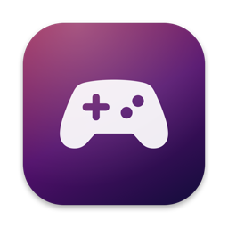
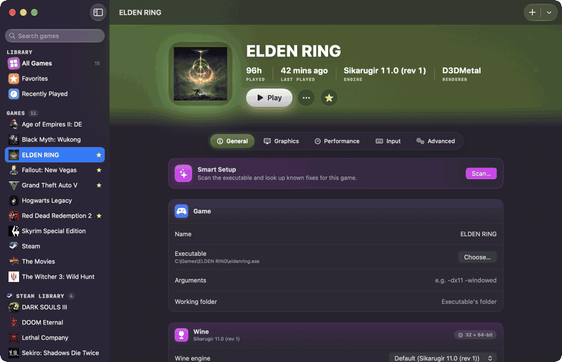
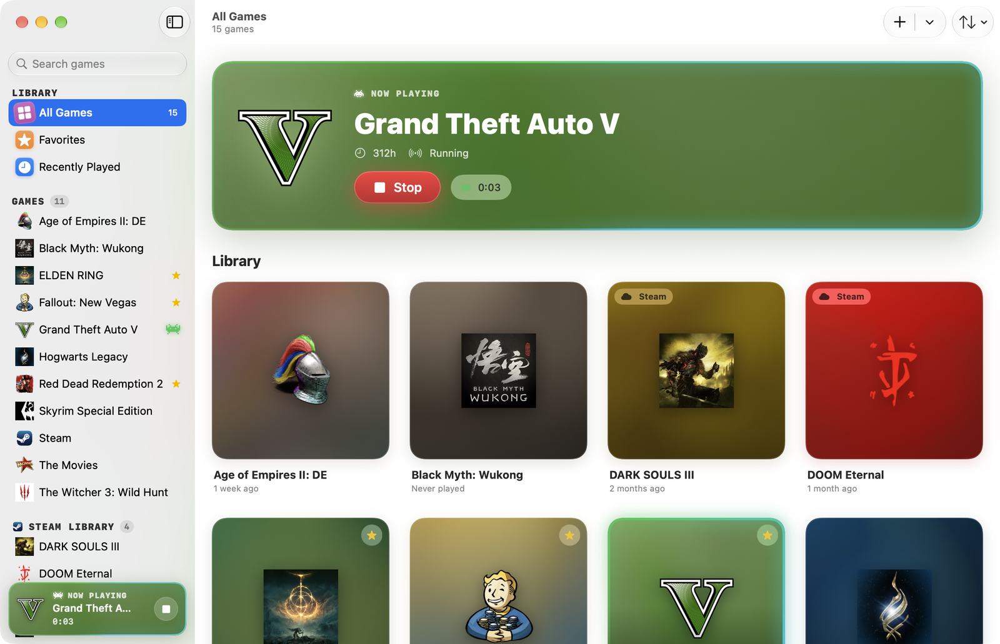
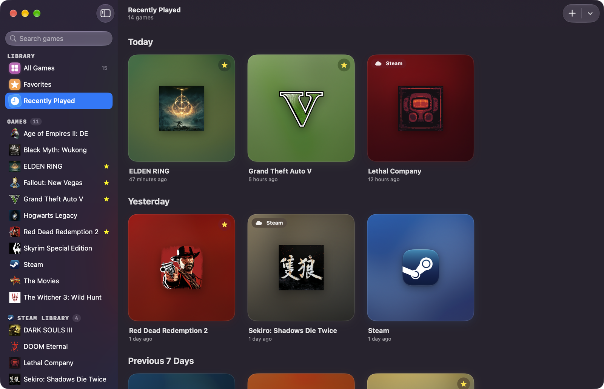
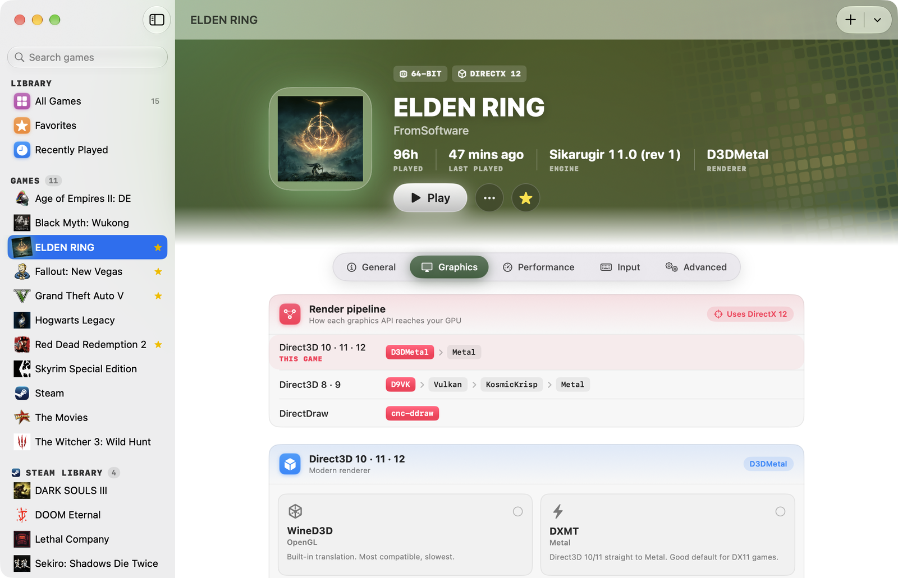
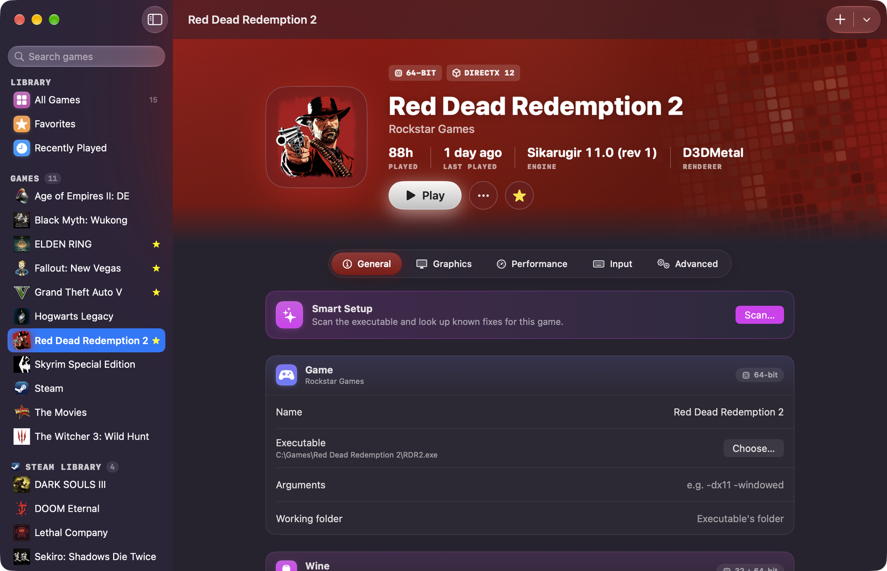
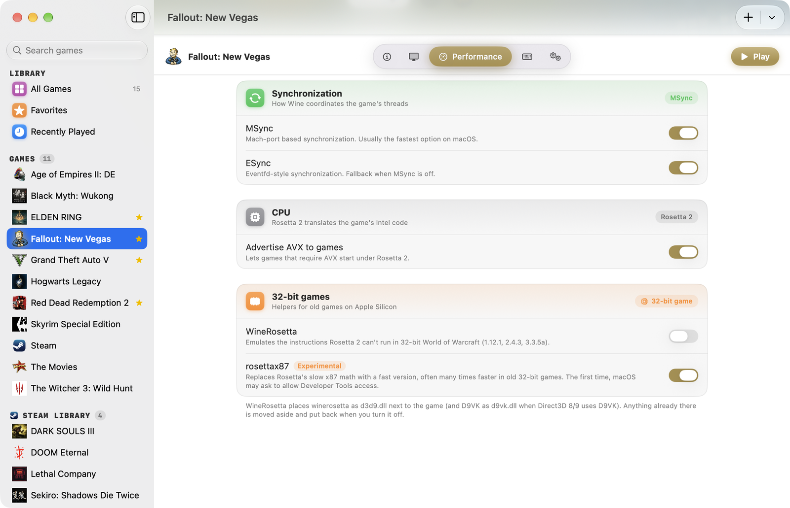
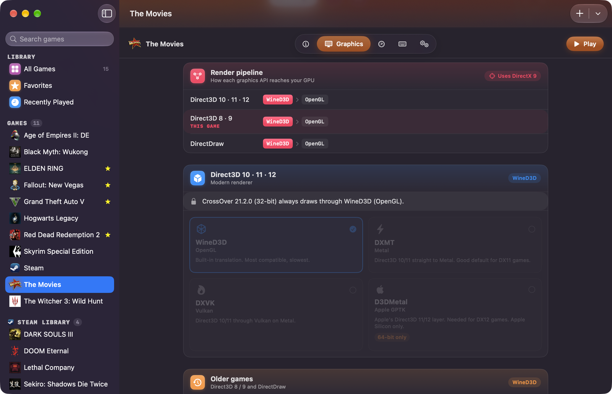

<p align="center">
  
</p>

<h1 align="center">notwindows</h1>

<p align="center">
  <b>A native macOS launcher for Windows games, built on Sikarugir's Wine engines and runtime.</b><br>
  One library, with its own settings for every game.
</p>

<p align="center">
  
  
  
  
</p>

<p align="center"></p>

notwindows keeps your Windows games in one library. Each game gets its own prefix and its own renderer, sync, display and input settings, applied every time it launches. Wine engines and the graphics runtime are downloaded once and shared by every game.

## Screenshots

| | |
| --- | --- |
|  |  |
| **Library:** artwork from each game's icon, a Now Playing banner and live timer | **Recently played**, grouped by day |
|  |  |
| **Graphics:** a renderer per game, and the path each DirectX version takes to Metal | **Game pages** read the `.exe`: 32/64-bit, DirectX version, engine and studio |
|  |  |
| **Performance:** MSync, ESync, AVX, WineRosetta and rosettax87 | **Locked settings** show what's actually in effect, and why |

## Features

- **Library:** icons from each `.exe`, favorites, recently played, sorting, search and playtime. Games started from a launcher (Steam, Battle.net, …) count as running until their last process exits.
- **Per-game settings:** Direct3D 10–12 through WineD3D, DXMT, DXVK or D3DMetal; Direct3D 8/9 through WineD3D or D9VK; cnc-ddraw; MoltenVK or KosmicKrisp; Retina, HUDs, MSync/ESync, AVX, key mapping, Windows version, DLL overrides and environment variables.
- **Old 32-bit games:** CrossOver's 32-bit engine, WineRosetta for 32-bit World of Warcraft clients and experimental [rosettax87](https://github.com/Lifeisawful/rosettax87_jit) for fast x87 math.
- **Smart Setup:** reads the executable (engine, DirectX, x87-heavy math, launchers, Steam DRM), matches the game against [Mac rules](Resources/mac-rules.json) for known games and engines, Steam's launch options, [umu-protonfixes](https://github.com/Open-Wine-Components/umu-protonfixes), [Lutris](https://lutris.net), [ProtonDB](https://www.protondb.com), [PCGamingWiki](https://www.pcgamingwiki.com) and [AppleGamingWiki](https://www.applegamingwiki.com), and suggests settings, engines and `.ini` changes with their sources. After a crash it reads the log for fixes, and a setup that played well is marked known good. Installs always wait for your review.
- **Share settings:** export a game's setup to a `.notwindows` file that anyone can import, or [share it with the community](community/), where Smart Setup lists it for other players of the game. It carries the settings, launch arguments, engine, Winetricks components, `.ini` changes and the Mac it ran on, but not your paths or play history.
- **Steam library:** install Windows Steam once and every game you install through it shows up as its own entry, with its own settings.
- **Browser sign-ins:** links like `jagex://` or `com.epicgames.launcher://` that Safari opens are handed back to the launcher in the right prefix.
- **Tools:** winecfg, regedit, Task Manager, a Winetricks browser with every verb, running programs in a prefix, and logs. Add installed games, run setup files, import Sikarugir/Wineskin wrappers, or drop an `.exe` on the window.
- **Engines:** Sikarugir, CrossOver (including 32-bit), GPTK and Whisky builds from Sikarugir's releases, plus upstream Wine Devel and Staging from Gcenx's macOS builds. Each engine shows what it supports, and settings it can't use are locked with the reason.

## Install

```bash
git clone https://github.com/alicin/notwindows.git
```

```bash
cd notwindows && scripts/build-app.sh
```

```bash
cp -R build/notwindows.app /Applications/
```

On first launch notwindows offers the runtime (~96 MB) and an engine (~167 MB). Engines are Intel builds, so Rosetta 2 is required (`softwareupdate --install-rosetta --agree-to-license`). The app is ad-hoc signed; if Gatekeeper complains, right-click it and choose **Open**.

## Development

Run `swift test`, build with `scripts/build-app.sh debug`, and set `NOTWINDOWS_HOME` to point the app at a separate library. Everything else lives in `~/Library/Application Support/notwindows`: `Engines`, `Runtime`, and one folder per game under `Games`.

At launch, [`WineEnvironment`](Sources/notwindows/Wine/WineEnvironment.swift) turns a game's settings into the environment Sikarugir's wrapper launcher exports, so renderer DLLs load straight from the shared runtime and nothing is copied into the prefix.

## Credits & licensing

The Wine engines, the runtime (MoltenVK, KosmicKrisp, DXVK, D9VK, DXMT, cnc-ddraw, GStreamer) and winetricks come from the [Sikarugir project](https://github.com/Sikarugir-App/Sikarugir) under their own licenses (Wine is LGPL-2.1). D3DMetal is © Apple and covered by the Game Porting Toolkit license, which doesn't allow commercial ports. notwindows isn't affiliated with Sikarugir, CodeWeavers or Apple.

<sub>Game names and icons in the screenshots belong to their publishers and are shown only to illustrate the app.</sub>

---

Big thanks to [Gcenx](https://github.com/Gcenx), creator of [Sikarugir](https://github.com/Sikarugir-App/Sikarugir). notwindows runs entirely on the engines and runtime Gcenx builds and maintains.
